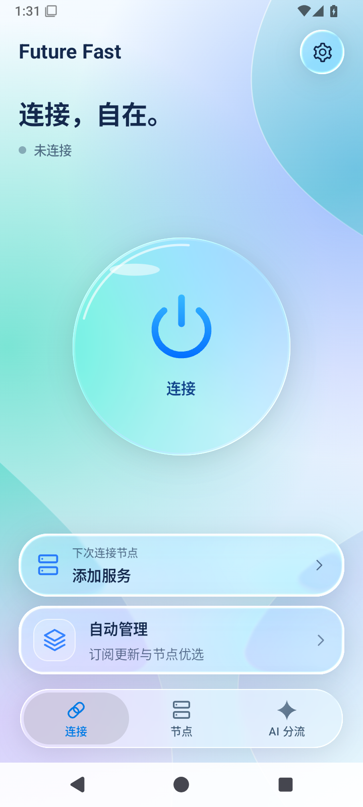
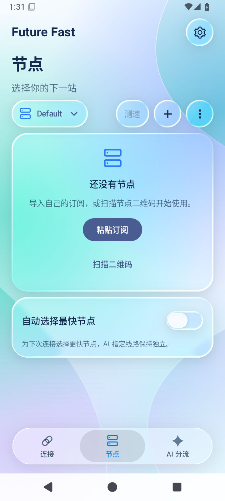
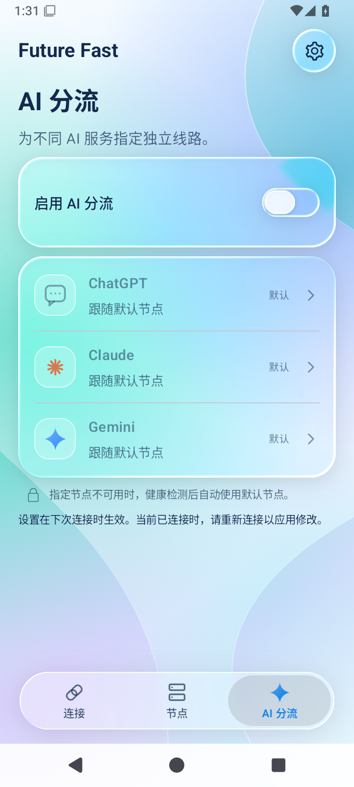
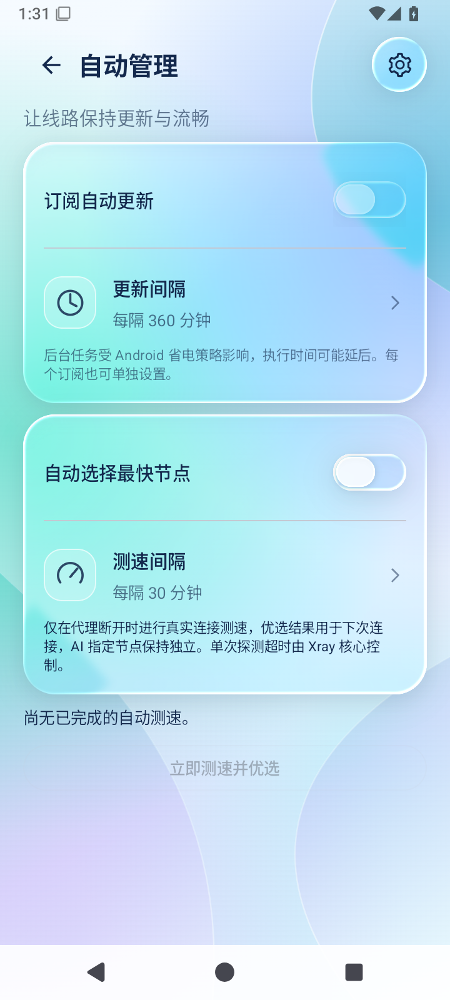
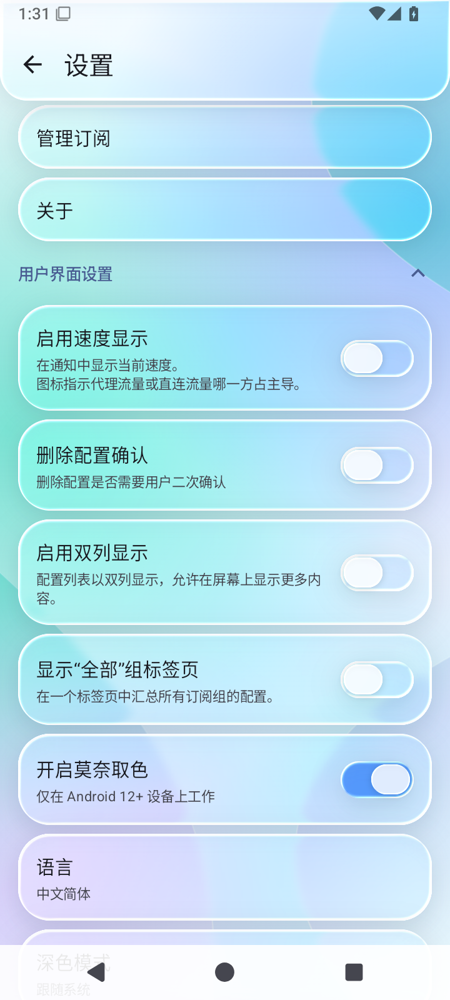
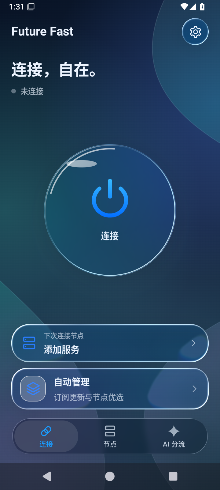

<div align="center">


# Future Fast

**连接，自在。**

由 **David Ren** 维护的 Android 网络连接与节点管理客户端。<br>
液态玻璃界面 · 水珠拖动导航 · 一键连接 · ChatGPT / Claude / Gemini 独立代理

[**下载 ARM64 APK**](https://github.com/davidren0513/FutureFast/releases/download/v0.4.3/FutureFast_0.4.3_arm64-v8a.apk) · [版本说明](https://github.com/davidren0513/FutureFast/releases/tag/v0.4.3) · [实际界面](#实际界面) · [功能说明](#功能说明)


[](LICENSE)

</div>

## 实际界面

<p align="center">
  
  
  
</p>
<p align="center"><sub>连接 · 节点 · AI 分流</sub></p>

<p align="center">
  
  
</p>
<p align="center"><sub>自动管理 · 设置</sub></p>

<details>
<summary>查看深色首页</summary>
<p align="center"></p>
</details>

以上为 **0.4.3 实际 APK** 在 Android 15 / API 35 ARM64 模拟器中的截图，使用简体中文、全新空节点状态，没有填入演示节点或虚构测速数据。[截图环境与来源](docs/screenshots/README.md)

界面参考 [Kyant0/AndroidLiquidGlass](https://github.com/Kyant0/AndroidLiquidGlass)，使用 Backdrop 的背景采样、模糊、透镜折射与高光。悬浮导航支持拖动水珠切换页面；玻璃按钮和开关保留按压形变、圆角点击涟漪。Android 13+ 使用实时玻璃效果，较旧系统采用渐变、半透明与高光降级。

## 下载与安装

当前版本为 **0.4.3 测试版**，只发布 **ARM64（arm64-v8a）**，适用于大多数现代 Android 手机；最低 Android 7.0。

| 文件 | 下载 |
| --- | --- |
| ARM64 安装包 | [FutureFast_0.4.3_arm64-v8a.apk](https://github.com/davidren0513/FutureFast/releases/download/v0.4.3/FutureFast_0.4.3_arm64-v8a.apk) |
| SHA-256 校验文件 | [SHA256SUMS](https://github.com/davidren0513/FutureFast/releases/download/v0.4.3/SHA256SUMS) |
| 更新记录与附件 | [v0.4.3 Release](https://github.com/davidren0513/FutureFast/releases/tag/v0.4.3) |

Release 附件可以直接下载，无需解压 GitHub Actions 的临时 Artifact。

1. 下载 APK 并安装。首次启动阅读并同意用户条款。
2. 在“设置 → 管理订阅”添加自己的订阅，或在“节点”页粘贴、扫描导入；在 Default 分组粘贴时导入该分组。
3. 确认节点后，返回连接页点击圆形按钮，按系统提示授权 VPN 连接。
4. 按需启用自动管理，或在“AI 分流”中分别指定服务线路。

**升级说明：** 本版仍使用测试签名，与此前单独提供的 0.4.x 本地测试包相同。早期 GitHub 预览构建的签名可能不同；如安装时提示签名冲突，请先在旧版导出配置并确认可恢复，再处理安装，避免丢失唯一配置。包名为 `tech.future.fast`，可与原版 v2rayNG 并存。

## 功能说明

| 功能 | 当前行为 |
| --- | --- |
| 简约连接首页 | 中央玻璃圆形按钮连接 / 断开；显示当前或下次使用的节点，自动管理快捷入口 |
| 水珠拖动导航 | 在连接、节点和 AI 分流间拖动切换，保留玻璃折射与按压反馈 |
| 节点管理 | 页面直接呈现分组和节点列表；支持导入、选择与测速；测速按钮直接显示“测试中” |
| 订阅管理 | 统一放在设置中，支持订阅自动更新与更新间隔 |
| 自动优选 | 断开代理时测试真实连接延迟，为下次连接选择有效的最快节点；不替换 AI 指定线路 |
| AI 独立代理 | ChatGPT、Claude、Gemini 分别选择独立节点，也可跟随默认节点 |
| AI 线路回退 | 独立线路健康检测失败后回退默认线路；设置变更在重新连接后生效 |
| 统一玻璃控件 | 设置、弹窗、开关沿用玻璃风格；整张开关卡片可点击，间隔按钮保持独立 |
| 首次使用条款 | 同意后才能进入应用功能；本地保存同意状态 |

连接、节点和 AI 分流三个主页面采用固定一屏布局，节点列表在自己的区域内滚动。订阅自动更新与自动优选默认关闭；间隔支持 **15–10080 分钟**，后台执行时间受 Android 调度、省电策略及网络状态影响。单节点测速超时由 Xray 核心控制。

AI 分流按照配置的域名规则工作，健康探测与回退存在检测时间；默认线路本身也需要可用。节点测速成功不代表某个 AI 平台必然允许访问，平台可用性还受网络、账号和提供方限制影响。

### Just My Socks 订阅

支持适用于本客户端的普通节点订阅；专用 Mihomo / Clash.Meta YAML 订阅不适用。节点地址或协议变化时，优先刷新订阅。本项目与 Just My Socks 没有官方合作或隶属关系。早期设计背景见 [JMS 适配计划](docs/JMS_CUSTOMIZATION.md)，当前实现以本页和版本记录为准。

## 验证记录

0.4.3 已通过 **121 项 JVM 测试**、Kotlin 编译、Playstore debug ARM64 打包、Lint、APK 签名和 16 KB ZIP 对齐检查。API 35 ARM64 模拟器检查了开关卡片触控、间隔按钮独立操作及圆角涟漪；0.4.2 还检查了键盘 / D-pad 操作和保存后重启状态。

真实手机、真实订阅、AI 平台端到端访问、完整 TalkBack 以及全部系统版本和布局组合尚未全部验证。详细范围及 **Not run** 项目见 [验证索引](docs/VALIDATION.md)、[0.4.3](docs/RELEASE_0.4.3.md)、[0.4.2](docs/RELEASE_0.4.2.md)、[0.4.1](docs/RELEASE_0.4.1.md)。

## 作者与开源致谢

**定制与维护：David Ren**<br>
GitHub：[davidren0513/FutureFast](https://github.com/davidren0513/FutureFast)

基于 [2dust/v2rayNG](https://github.com/2dust/v2rayNG) 修改，感谢 2dust 与 v2rayNG contributors，以及 [Xray-core](https://github.com/XTLS/Xray-core)、[AndroidLibXrayLite](https://github.com/2dust/AndroidLibXrayLite)、[HEV Socks5 Tunnel](https://github.com/heiher/hev-socks5-tunnel) 的作者和贡献者。

液态玻璃效果使用 [Kyant0/AndroidLiquidGlass / Backdrop](https://github.com/Kyant0/AndroidLiquidGlass)，感谢 Kyant0 及贡献者。相关授权与归属见 [第三方说明](THIRD_PARTY_NOTICES.md) 和 [Apache 2.0 许可证](licenses/AndroidLiquidGlass-APACHE-2.0.txt)。

**鸣谢：未界科技 提供技术指导支持**

项目遵循 [GNU GPL v3](LICENSE)。原有版权和依赖许可证继续保留。[上游原始 README](docs/UPSTREAM_README.md) 作为参考，其中的发布地址、签名和社区信息不代表 Future Fast。

## 使用说明

本应用仅为网络连接配置与管理工具，不提供代理节点、代理订阅、服务器、网络接入或 AI 账号服务。请自行配置有权使用的服务，遵守所在地及相关适用法律法规与服务条款。首次启动需阅读并同意应用内用户条款。

请勿将订阅地址、节点密码、私钥或含有这些信息的截图和日志提交到公开仓库。

## 开发与维护

Android 工程位于 `V2rayNG/`。首次构建需递归初始化子模块，并按[构建工作流](.github/workflows/future-fast-preview.yml)准备 HEV 原生库及与源码版本匹配的 Xray AAR。工具链和依赖版本以工作流及 Gradle 配置为准。

```sh
git clone --recursive https://github.com/davidren0513/FutureFast.git
cd FutureFast
```

[发布版本](https://github.com/davidren0513/FutureFast/releases) · [开发构建](https://github.com/davidren0513/FutureFast/actions/workflows/future-fast-preview.yml)
